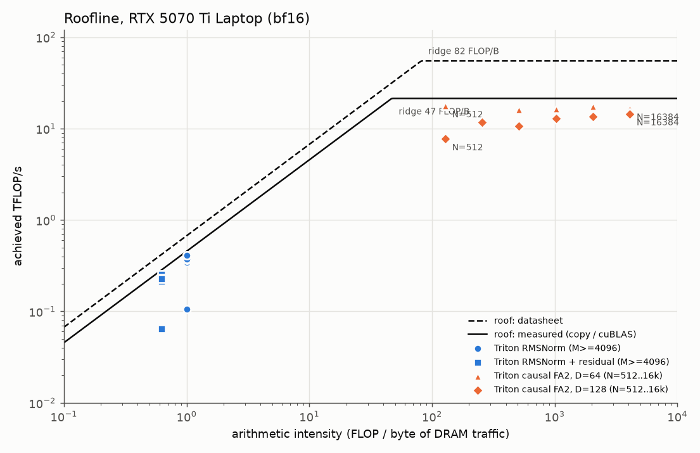
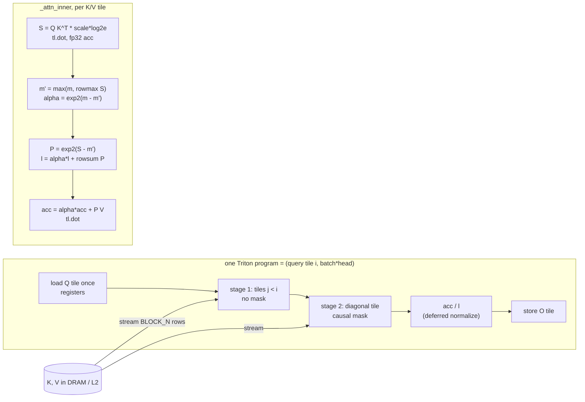
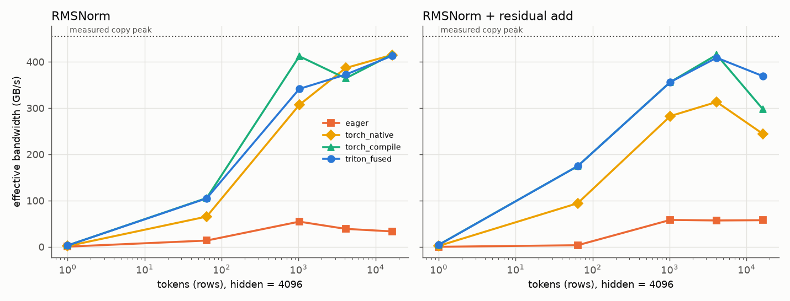
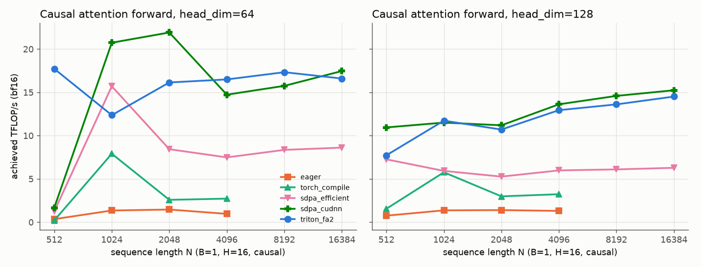

# triton-fused-kernels-roofline

Two fused GPU kernels written from scratch in Triton, checked against PyTorch,
benchmarked against PyTorch's best, and placed on a roofline of the GPU they ran on:

| kernel | file | what is fused | bound by |
|---|---|---|---|
| RMSNorm forward (+ optional residual add) | [`src/fusedkernels/rmsnorm.py`](src/fusedkernels/rmsnorm.py) | `h = x + r; y = h * rsqrt(mean(h^2) + eps) * w` in one pass | DRAM bandwidth |
| Causal attention forward, FlashAttention-2 style | [`src/fusedkernels/attention.py`](src/fusedkernels/attention.py) | `QK^T`, scale, causal mask, online softmax, `PV`, normalize: the N x N matrix never leaves the SM | tensor cores (for N above a few hundred) |

The aim is to teach. The question it answers is *why* one of these kernels can
only ever be as fast as memory, why the other can only ever be as fast as the
tensor cores, and how to measure which wall you are hitting. Everything in the
results section was measured on one laptop GPU. Nothing in it is simulated; the
only modeled quantities are the FLOP and byte counts used to convert times into
TFLOP/s, GB/s and arithmetic intensity (formulas in the source).

---

## 1. The physics: arithmetic intensity and the roofline

A kernel does two things: it moves bytes between DRAM and the SMs, and it does
FLOPs on them. Both have a hardware ceiling, so a kernel can never run faster than

```
time >= max( bytes / peak_bandwidth ,  flops / peak_flops )
```

Divide FLOPs by bytes and you get the **arithmetic intensity** `AI` (FLOP/byte).
The roofline (Williams, Waterman & Patterson, 2009) is that inequality drawn as a
chart:

```
attainable FLOP/s = min( peak_flops , peak_bandwidth * AI )
```

The two roofs meet at the **ridge point** `peak_flops / peak_bandwidth`. A
kernel to the left of the ridge is **memory bound**: buying more FLOP/s does not
help, and the only thing that helps is moving fewer bytes. That is what *fusion*
does. A kernel to the right is **compute bound**: you win by keeping the tensor
cores fed.

### The GPU used here

The GPU is a GeForce RTX 5070 Ti **Laptop** (GB205, Blackwell consumer, sm_120,
46 SMs, 12 GB GDDR7, 192-bit bus). Sources are in [docs/SOTA.md](docs/SOTA.md).

| roof | datasheet | measured here | how it was measured |
|---|---|---|---|
| DRAM bandwidth | 192 bit / 8 x 28 Gbps = **672 GB/s** | **455 GB/s** (68%) | `y.copy_(x)` and a Triton copy kernel, 128 MB buffers, L2 flushed ([bench_peak.py](benchmarks/bench_peak.py)) |
| FP16/BF16 tensor, FP32 accumulate | **~55 TFLOP/s** dense | **21.4 TFLOP/s** (39%) | cuBLAS `a @ b`, 2048^3 |
| ridge point | 82 FLOP/B | **47 FLOP/B** | |

The measured roofs sit well below the datasheet. The reason is a laptop GPU
sharing a machine with other jobs: during the benchmarks `nvidia-smi` reported a
median SM clock of **855-922 MHz** (the boost clock is ~1.8 GHz), a temperature of
86-89 C, and a thermal/power slowdown flag ([results/*clocks*.json](results/)).
Tensor throughput scales with the SM clock, so roughly half the peak is simply
missing. That is why every chart here uses the **measured** roof as the real
ceiling and shows the datasheet roof only as a reference line.



---

## 2. RMSNorm: a memory-bound kernel

```
y_i = x_i / sqrt( (1/N) * sum_j x_j^2 + eps ) * w_i
```

**Counting.** Per element the kernel does `x*x`, an add into the sum, `*rstd` and
`*w`, so 4 FLOPs. It reads 2 bytes (bf16) and writes 2 bytes. That gives

```
AI = 4 FLOP / 4 B = 1 FLOP/byte      (47x to the left of the ridge)
```

Worked example: 16384 tokens x 4096 hidden in bf16 is 134 MB in plus 134 MB out,
268 MB in total. At the measured 455 GB/s that takes **0.59 ms**, and the FLOPs
take 0.27 GFLOP / 21.4 TFLOP/s = **0.013 ms**. The tensor cores do not matter at
all and the ALUs barely do. The only lever is the number of bytes.

**Why fusion wins.** The naive eager PyTorch composite
(`x.float().pow(2).mean(-1)`, `rsqrt`, `mul`, `mul`, `.to(bf16)`) launches about 7
kernels, and each one round-trips a full tensor (some of them fp32) through DRAM.
Our kernel puts **one program on one row**. It loads the row into registers
once, reduces it in fp32, and writes `y` once. That is the 2-tensor minimum.

**Fused residual add.** In a pre-norm transformer the norm always follows
`h = x + residual`:

| | DRAM tensors moved |
|---|---|
| unfused: `h = x + r` then `rmsnorm(h)` | read x, read r, write h, **read h**, write y = 5 |
| fused `rmsnorm(x, w, residual=r)` | read x, read r, write h, write y = **4** |

That is the `fused_add_rms_norm` contract of vLLM and SGLang. The kernel rounds
`h` to bf16 *before* normalizing, so the residual stream is **bit-identical** to
the unfused model's. A test asserts `torch.equal(h, x + r)`.

Kernel details worth reading in the source: int64 row offsets (rows x stride
overflows int32 at long contexts), an fp32 sum of squares (an fp16 sum of N squares overflows
once |x| > sqrt(65504 / N), i.e. |x| > 4 at N = 4096; the test uses |x| = 200), and `num_warps` scaled with the row
length so each thread keeps ~8-16 elements in flight.

---

## 3. Causal attention: a compute-bound kernel (for long sequences)

```
O = softmax( Q K^T / sqrt(D) + causal_mask ) V          Q, K, V, O : [B, H, N, D]
```

**Counting, per head.** `QK^T` and `PV` each cost `2 * N * N * D` FLOPs. Causal
masking skips the upper triangle, so the total is `4 * D * N(N+1)/2`. The
compulsory traffic is to read Q, K, V once and write O once, which is
`4 * N * D * 2` bytes in bf16. So

```
AI_causal ~ (N + 1) / 4  FLOP/byte          (independent of D)
N = 512   ->  128 FLOP/B   (already 2.7x right of the measured ridge)
N = 4096  -> 1024 FLOP/B
crossover with the measured ridge (47 FLOP/B):  N ~ 190
```

This is the "attention is compute bound for long sequences" statement in one
line. FLOPs grow as N^2 and the unavoidable bytes grow as N.

**Why naive attention is still slow.** Eager attention *materializes* S = QK^T
and P = softmax(S). Each is `B*H*N^2` elements. At N = 4096, H = 16 that is 268M
elements, about 1 GB in fp32, written and read several times. Its *real* AI
collapses to O(D), which puts it back on the bandwidth roof. Measured: eager runs
at **1.0-1.5 TFLOP/s**, about 10x slower than the fused kernel.

### Tiling

Each Triton program owns a `BLOCK_M x D` tile of queries and keeps it in
registers for its whole lifetime. It streams `BLOCK_N x D` tiles of K and V past
that tile:

```
              K/V tiles (BLOCK_N rows each)  ---->
            j=0    j=1    j=2    j=3
Q tile i=0 [diag]   .      .      .        . = skipped (above diagonal, causal)
Q tile i=1 [full] [diag]   .      .        full = unmasked fast path
Q tile i=2 [full] [full] [diag]   .        diag = masked path, only BLOCK_M/BLOCK_N tiles
Q tile i=3 [full] [full] [full] [diag]

grid = (ceil(N / BLOCK_M), B * H)         launched largest-row-first to fill the tail
```

Each K/V tile is loaded once per query tile, so the inner loop does
`4 * BLOCK_M * BLOCK_N * D` FLOPs (two GEMMs, `QK^T` and `PV`) per `2 * BLOCK_N * D * 2`
bytes of K/V, an **AI of BLOCK_M FLOP/B (64-128)**. That holds even when every K/V re-read misses
L2 and goes to DRAM, and it is still above the 47 FLOP/B ridge. Tiling is what
turns the N^2 FLOPs into on-chip work.

### Online softmax, derived

Softmax needs the row max (for stability) and the row sum, and both depend on
the *whole* row. We only ever see one tile of it. Suppose we have processed
columns `1..j` and kept

```
m   = max over seen columns of s_k
l   = sum over seen columns of exp(s_k - m)
acc = sum over seen columns of exp(s_k - m) * v_k
```

A new tile with scores `s'` arrives. Let `m' = max(m, max(s'))`. Since
`exp(s_k - m') = exp(s_k - m) * exp(m - m')`, every old term is the same term
multiplied by the same factor `alpha = exp(m - m')`. So

```
l'   = alpha * l   + sum exp(s' - m')
acc' = alpha * acc + exp(s' - m') @ V_tile
```

These are exactly the old quantities as if they had been computed with the new
max all along. After the last tile, `O = acc / l`. That is the whole trick
(Milakov & Gimelshein, 2018). FlashAttention-2's refinements, which are in the
code:

* the division by `l` is **deferred** to the end, one divide per row instead of one per tile;
* `exp` becomes `exp2`, with `log2(e)` folded into the softmax scale, because `exp2` is the native SFU instruction;
* `P` is cast to bf16 before the second `tl.dot`, so `PV` also runs on the tensor cores, while `acc` stays fp32;
* the causal mask is applied **only on diagonal tiles**. Tiles below the diagonal run a mask-free loop and tiles above it are never visited.

Worked example with two tiles of a single row. `s = [2, 1 | 5]`, `v = [a, b | c]`:
tile 1 gives `m=2, l=1+e^-1=1.368, acc=a+0.368b`. Tile 2 gives `m'=5, alpha=e^-3=0.0498`,
`l' = 0.0498*1.368 + 1 = 1.068`, `acc' = 0.0498a + 0.0183b + c`. Dividing,
`O = 0.0466a + 0.0171b + 0.936c`, which is exactly `softmax([2,1,5]) @ [a,b,c]`.

### How the code maps to the theory



---

## 4. Results (measured on this machine)

**Hardware and software:** NVIDIA GeForce RTX 5070 Ti Laptop GPU (sm_120, 46 SMs,
11.9 GB usable), driver 591.86, Windows 11 (26200), Python 3.12.13, torch
2.11.0+cu128, triton-windows 3.5.1. Timing uses `triton.testing.do_bench`, median
over reps. The L2 (40 MB per the spec sheet) is flushed between reps, so the numbers are
DRAM-cold. All benchmarks are bf16. Exact environment: [results/env.json](results/env.json).

> **Measurement caveat.** The GPU was shared with other jobs and was thermally
> throttled (median SM clock ~0.9 GHz). Absolute numbers are therefore low and
> somewhat noisy. *Relative* comparisons inside one table were taken back to back
> and are more trustworthy. The hidden = 8192, 16384-token RMSNorm rows (256 MB
> tensors) dropped to ~100 GB/s for **every** implementation, eager included. We
> treat them as interference and draw no conclusion from them. They are still in
> the CSV, and they are the low outlier on the roofline plot.

### RMSNorm (hidden = 4096, time in microseconds, lower is better)

| tokens | eager composite | `F.rms_norm` | `torch.compile` | **Triton fused** | Triton GB/s (% of measured copy peak) |
|---:|---:|---:|---:|---:|---:|
| 1 | 56.9 | 14.3 | 8.0 | **8.2** | launch-bound |
| 1024 | 308.0 | 54.7 | 40.7 | **49.2** | 342 (75%) |
| 4096 | 1727 | 173.6 | 184.2 | **180.2** | 372 (82%) |
| 16384 | 8041 | 647.0 | 645.8 | **650.0** | 413 (91%) |

**With fused residual add** (`h = x + r` and the norm):

| tokens | eager (add + composite) | add + `F.rms_norm` | `torch.compile` | **Triton fused** | Triton GB/s |
|---:|---:|---:|---:|---:|---:|
| 1 | 586 | 20.3 | 9.1 | **10.0** | launch-bound |
| 1024 | 577 | 118.7 | 94.2 | **94.2** | 356 |
| 4096 | 2354 | 428.5 | 323.3 | **328.3** | 409 |
| 16384 | 9321 | 2200 | 1806 | **1455** | 369 |



What to read from this:
* At large M the fused kernel reaches **82-91% of the measured copy bandwidth**,
  and the copy kernel is the ceiling for any memory-bound kernel. There is
  almost nothing left to gain.
* `torch.compile` (Inductor generates a Triton kernel that is essentially this
  one) and PyTorch's native `F.rms_norm` are equally good **without** the
  residual. A hand-written kernel only wins where it moves fewer bytes: with
  the residual, `add + F.rms_norm` is 1.3-1.5x slower than the fused kernel,
  because `h` makes an extra round trip. That is the 5-vs-4 tensor argument from
  section 2, measured.
* The eager composite is 9-12x slower at large M (fp32 intermediates and 7
  launches). At M = 1 every implementation is bound by launch latency (~8 us).
  Decode-time norms are a CPU and launch problem, which is why engines use CUDA
  Graphs. The very high eager numbers with the residual at small M (~0.5 ms) come
  from CPU-side launch overhead on a busy machine. They are not a GPU effect.
  Full grid (hidden 1024/4096/8192): [results/rmsnorm.csv](results/rmsnorm.csv).

### Causal attention (B = 1, H = 16, bf16, time in ms)

| D | N | eager | `torch.compile` | SDPA mem-efficient | SDPA cuDNN | **Triton FA2** | Triton TFLOP/s | vs cuDNN |
|---:|---:|---:|---:|---:|---:|---:|---:|---:|
| 64 | 2048 | 5.90 | 3.33 | 1.02 | 0.392 | **0.532** | 16.1 | 0.74x |
| 64 | 4096 | 35.8 | 12.6 | 4.59 | 2.33 | **2.08** | 16.5 | 1.12x |
| 64 | 8192 | - | - | 16.5 | 8.73 | **7.93** | 17.3 | 1.10x |
| 64 | 16384 | - | - | 63.9 | 31.5 | **33.1** | 16.6 | 0.95x |
| 128 | 1024 | 3.15 | 0.746 | 0.726 | 0.374 | **0.367** | 11.7 | 1.02x |
| 128 | 4096 | 52.9 | 21.3 | 11.5 | 5.05 | **5.31** | 12.9 | 0.95x |
| 128 | 16384 | - | - | 175 | 72.2 | **75.8** | 14.5 | 0.95x |

(Full grid with N = 512 ... 16384: [results/attention.csv](results/attention.csv).
Eager and compile were skipped above N = 4096 because the materialized scores
would need several GB of VRAM. The FLOP/byte axis on the roofline uses compulsory traffic.)



What to read from this:
* The Triton kernel reaches **16-17 TFLOP/s at D = 64**, which is **~80% of the
  measured cuBLAS roof** (21.4). For N >= 4096 it is within ±12% of cuDNN's fused
  attention, the fastest backend PyTorch has on this GPU (at N = 2048, D = 64 it is
  26% slower), and about 2x (1.9-2.3x) faster than SDPA's memory-efficient backend.
* **SDPA's FlashAttention backend is not available** in this torch build on sm_120
  (`No available kernel`, recorded in [results/attention_meta.json](results/attention_meta.json)),
  so the comparison is against cuDNN and mem-efficient.
* `torch.compile` of the eager code does **not** discover FlashAttention. It
  fuses the softmax but still materializes the N x N scores, so it is only 2-4x
  better than eager. Algorithmic restructuring (online softmax) is not a fusion a
  graph compiler can do by pattern-matching elementwise ops.
* D = 128 is slower than D = 64 in TFLOP/s. The likely reason (we have not
  verified it with counters) is register pressure: a 128-wide fp32 accumulator
  plus the Q tile per program lowers occupancy. FA3/FA4 address this with warp
  specialization and tensor memory, which this GPU lacks (see docs/SOTA.md).
* Short sequences are where the GPU is hardest to fill: at N = 512 there are
  only 4-8 query tiles x 16 heads = 64-128 programs for 46 SMs (D = 128 reaches
  7.7 TFLOP/s there). That is FA2's motivation for parallelizing over the
  sequence dimension, and it is also why batch size matters. The N <= 1024 rows
  are sub-0.4 ms runs and were the noisiest on the shared GPU (e.g. cuDNN at
  N = 512, D = 64 timed *slower* than at N = 1024), so read them with care.

### Nsight Compute

See [section 6](#6-nsight-compute-how-to-run-and-what-happened) for the exact
command and what happened.

---

## 5. How to run

```bash
pip install -r requirements.txt        # Windows: triton-windows instead of triton
pytest -q                              # 42 numerics tests, ~20 s on a GPU (skipped without CUDA)

python benchmarks/bench_peak.py        # measure the two roofs -> results/peak.json
python benchmarks/bench_rmsnorm.py     # -> results/rmsnorm.csv
python benchmarks/bench_attention.py   # -> results/attention.csv
python benchmarks/plot_results.py      # -> results/*.png (CPU only)
python scripts/run_ncu.py              # Nsight Compute, see below
```

```python
import torch
from fusedkernels import rmsnorm, causal_attention
x = torch.randn(4096, 4096, device="cuda", dtype=torch.bfloat16)
y, h = rmsnorm(x, torch.ones(4096, device="cuda", dtype=torch.bfloat16), residual=x)
q = k = v = torch.randn(1, 16, 4096, 128, device="cuda", dtype=torch.bfloat16)
o = causal_attention(q, k, v)
```

On the shared dev machine every GPU command was wrapped in a machine-wide GPU
lock (`_tools/gpu_lock.py`, outside this repo). Peak VRAM is < 3 GB (eager
attention at N = 4096 is the largest allocation).

**Numerics tests** ([tests/](tests/)): fp16 and bf16, against an fp32 oracle, with
tolerances of about 2 ulp of the output dtype (fp16 2e-3, bf16 1.6e-2). Shapes
include non-power-of-2 hidden sizes, N not a multiple of any tile, N = 1,
non-contiguous `[B, N, H, D]` views, and scaled logits with std ~64 and extremes near ±300 (exp overflows fp32 above 88; online-softmax
stability). Other tests check that causality holds bit-exactly (changing future
K/V leaves earlier outputs unchanged), that the residual stream is bit-identical
to `x + r`, and that the attention error is no worse than 2x PyTorch SDPA's own
error vs fp32.

---

## 6. Nsight Compute: how to run and what happened

[`scripts/ncu_target.py`](scripts/ncu_target.py) warms up (JIT plus autotune)
outside the profiled range, then launches each kernel once between
`cudaProfilerStart/Stop`. [`scripts/run_ncu.py`](scripts/run_ncu.py) runs:

```bash
ncu --profile-from-start off --target-processes all \
    --metrics gpu__time_duration.sum,dram__bytes.sum,\
dram__throughput.avg.pct_of_peak_sustained_elapsed,\
sm__throughput.avg.pct_of_peak_sustained_elapsed,\
sm__warps_active.avg.pct_of_peak_sustained_active \
    --csv python scripts/ncu_target.py
```

`sm__warps_active.avg.pct_of_peak_sustained_active` is "achieved occupancy". On
Windows, GPU performance counters need admin rights, or "Allow access to the GPU
performance counters to all users" enabled in the NVIDIA Control Panel. Without
that, ncu returns `ERR_NVGPUCTRPERM`. Blackwell (sm_120) needs **Nsight Compute
2025.1 or newer**.

**What happened on this machine (honest account):**

1. Nsight Compute 2024.1.1 (the only version installed) first failed before it
   ever touched the GPU with `Failed to parse options: No mapping for the
   Unicode character exists in the target multi-byte code page`. Cause: the
   Windows user name contains a non-ASCII character, and ncu 2024.1 cannot handle
   that in **any** environment variable (USERPROFILE, APPDATA, PATH...), not just
   in its arguments. `run_ncu.py` now rewrites non-ASCII environment values and
   arguments to their 8.3 short paths, which are pure ASCII. That fixed it.
2. The second run attached to the process and then stopped with
   **`ERR_NVGPUCTRPERM`**: performance counters are restricted to administrators on
   this machine, and changing that needs an admin and NVIDIA Control Panel access,
   which this project did not have. The exact log is in
   [results/ncu_attempt.txt](results/ncu_attempt.txt).

So **no ncu metrics are reported here**. Even with counters enabled, 2024.1.1
predates official sm_120 support, so it might still refuse the GPU. What we
report instead is the "analytic + measured" roofline: compulsory bytes and FLOPs
counted from the algorithm, divided by measured wall time. As a stand-in for
`dram__throughput`, the RMSNorm kernel's effective bandwidth (82-91% of the
measured copy peak) is a *lower bound* on its real DRAM throughput. For
attention, achieved TFLOP/s against the cuBLAS roof (~80% at D = 64) plays the
role of `sm__throughput`. Occupancy was **not measured**. To get real numbers,
install Nsight Compute >= 2025.1, enable counter access, and run
`python scripts/run_ncu.py --ncu <path-to-ncu>`. The script writes
`results/ncu_metrics.csv`.

Expected ncu signature, for anyone who reruns this: RMSNorm should show high
`dram__throughput` (> 80%) with low `sm__throughput`. Attention at N = 4096 should
show the opposite: high SM/tensor-pipe throughput and low DRAM throughput.

---

## 7. Limitations, and what production systems do differently

* **Forward only.** No backward pass (FA2's backward is roughly 2.5x the work and a separate kernel).
* **No GQA/MQA, no KV cache, no paging, no varlen batching, no sliding window,
  no dropout.** Production prefill kernels (FlashAttention, FlashInfer, the vLLM
  and SGLang Triton backends) take ragged batches and paged KV. Decode (one
  query token) is memory bound and uses split-KV ("flash-decoding"), which is a
  different kernel.
* **FA3/FA4 do not apply here.** They rely on Hopper and datacenter-Blackwell
  hardware (WGMMA, TMA, warp specialization, tcgen05/TMEM) that sm_120 does not
  expose. On this GPU, `mma.sync` plus FA2's structure is the right design. On
  H100/B200 this kernel would leave about 2x on the table.
* **RMSNorm is not fused with its neighbours.** Engines fuse the norm into the
  *next* op as well (FP8/FP4 output quantization, or the QKV GEMM prologue), so
  the normalized activation never touches DRAM. Beyond ~90% of copy bandwidth,
  that is the only way to go faster.
* **Rows wider than 16384** are rejected. A two-pass or split-row reduction would be needed.
* **Small autotune space** (5 configs) and a small benchmark grid. Measured on
  one thermally limited laptop GPU, so numbers on a desktop part will differ.
* The attention "bytes" on the roofline are **compulsory** traffic. The kernel
  actually re-reads K/V once per query tile, mostly from L2.

## 8. Exercises / next steps

1. Add GQA: map query head `h` to KV head `h // (H / H_kv)` in the pointer math and check the result against `repeat_interleave`.
2. Write the backward pass (recompute P from the saved `logsumexp = m + log l`, which you also need to store).
3. Remove the deferred normalization (divide every tile) and measure the cost. Then remove the diagonal/off-diagonal split and measure that.
4. Add an FP8 (e4m3) output to RMSNorm and measure the bandwidth gain (2 bytes to 1 per output element).
5. Sweep `BLOCK_M` and plot TFLOP/s against the K/V re-read arithmetic intensity (~BLOCK_M FLOP/B).

## 9. Further reading

See [docs/SOTA.md](docs/SOTA.md): roofline (Williams et al. 2009), RMSNorm
(arXiv:1910.07467), online softmax (arXiv:1805.02867), FlashAttention 1/2/3/4
(arXiv:2205.14135, 2307.08691, 2407.08608, 2603.05451), FlashInfer
(arXiv:2501.01005), Liger Kernel (arXiv:2410.10989), and the Triton fused-attention
tutorial.

---

License: MIT. Part of the series: https://github.com/Kripta-Studios/llm-inference-engineering-roadmap
